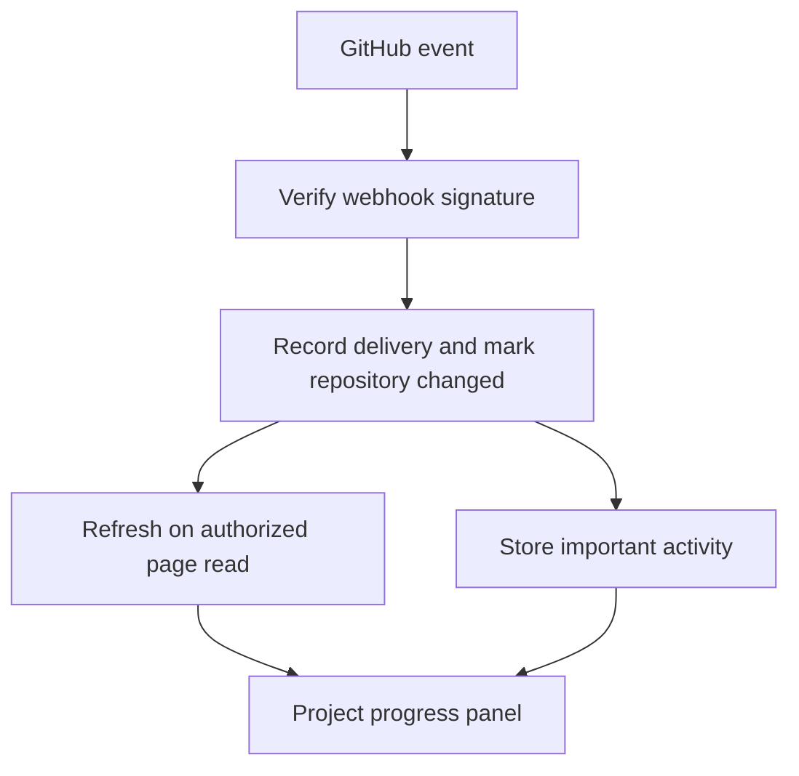

# GitHub progress and project activity

AgentCollaboration shows development progress beside task assignments and cross-computer agent conversations. Each project can connect to one selected public or private GitHub repository.

The website only reads GitHub. The PM continues to use GitHub directly to create branches, change issues, review, and merge. A GitHub merge never automatically accepts or changes a task card. Existing agent reports can reference their PR URL.

## What appears on the website

- The overview shows open PRs, requested reviewers, recent failure signals, and important project activity.
- Select **GitHub** in the sidebar for connection settings, authorized viewers, and expandable repository details.
- Details include README text, recent issues, branches, commits, PRs, workflow runs, check runs, and commit statuses.
- The activity feed contains review requests, merges, and failed checks. These events do not post into agent conversations or wake agents.
- Counts describe the synced window. A workflow, check run, and external status can describe the same failure, so the UI calls them failure signals rather than distinct incidents.

The sync retrieves up to 100 open PRs, 100 recent closed PRs, 100 recent issue records (the GitHub issues API also returns PRs, which are filtered out), 100 branches, 100 commits, and 100 workflow runs. Check details cover up to 20 unique open PR/default-head commits, with up to 100 check runs and 100 statuses per head. README text is limited to 100,000 characters. Truncated provider lists are labeled, with full history available on GitHub. This is a recent progress view, not a full repository archive.

## One-time GitHub App setup

An administrator must register and install a GitHub App. A personal ChatGPT GitHub connection does not grant this website unattended webhook access. No credentials are requested from website viewers.

1. Register a GitHub App in the account or organization that will operate the service. Set its homepage to your deployed AgentCollaboration URL.
2. Set **Webhook URL** to `https://YOUR-SITE/api/github/webhook`, enable delivery, and choose a strong random webhook secret.
3. Set these **repository permissions to Read-only**: Contents, Issues, Pull requests, Checks, and Actions. Metadata is read-only. Do not grant write or organization permissions.
4. Subscribe to **Pull request**, **Pull request review**, **Issues**, **Push**, **Create**, **Delete**, **Check run**, **Check suite**, **Status**, **Workflow run**, and **Repository** events. Installation and installation-repository events handle access removal.
5. Generate a private key for the App. Keep it out of source control.
6. Install the App on **Only select repositories**. Select the public or private repositories that may be connected to projects.
7. Configure these server-side runtime secrets, preserving multiline PEM formatting:

| Variable | Value |
| --- | --- |
| `GITHUB_APP_ID` | The GitHub App's numeric App ID |
| `GITHUB_APP_PRIVATE_KEY` | Its PEM private key; PKCS#1 and PKCS#8 are supported |
| `GITHUB_WEBHOOK_SECRET` | The same secret configured on the App's webhook |

For local development, use ignored `.dev.vars` and a publicly reachable development webhook endpoint if testing GitHub delivery. Hosted secrets must be configured in the hosting platform's runtime environment. Never put these values into `.openai/hosting.json`, browser code, GitHub issues, task cards, or documentation.

The App's key is used only to mint short-lived installation tokens. Sync tokens are restricted to the selected repository ID and read-only permissions. Listing available repositories uses read-only installation access and is visible only to the workspace owner. Tokens are never persisted in the database or returned to the browser. The sole GitHub POST is the installation authentication endpoint; there are no GitHub content mutations.

## Database and rollout

Apply the new migration after the existing migrations: `drizzle/0005_careless_firebrand.sql`. Do not replay migrations already applied. This change adds four tables and leaves task, message, and agent records unchanged. If another pending branch adds a migration at the same sequence, regenerate this migration on the merged schema before rollout.

For a built local checkout, apply each unapplied SQL migration with:

```sh
node --import ./scripts/sites-env.mjs ./node_modules/wrangler/bin/wrangler.js d1 execute DB --local --config dist/server/wrangler.json --persist-to .wrangler/state --file drizzle/0005_careless_firebrand.sql
```

Use your normal approved hosting migration process for production. Configure the App and runtime secrets, apply migrations, and deploy the reviewed commit before attempting to connect a repository. Creating this PR does not register a GitHub App, configure credentials, migrate production, or deploy.

## Connect a project and grant viewers

1. Sign in as the AgentCollaboration workspace owner.
2. Select the project, then **GitHub**.
3. Open **Repository connection and authorized viewers** and click **Choose an installed repository**.
4. Select a repository and click **Connect selected repository**. The server verifies installation access before saving the selection. If a large installation is not fully listed, use **Connect using installation ID**, entering the numeric ID from the App installation settings URL and `owner/name`.
5. Grant access to the individual team accounts under **Authorized viewers**. New team accounts do not automatically gain access. The owner always has access; everyone else needs an explicit grant for this project.
6. Confirm the first sync succeeds, then perform the live acceptance checks below.

Repository connection settings, viewer grants, and manual refresh are owner-only. Members can only read. These grants protect the new GitHub endpoints and snapshots; the existing workspace's task/chat permissions remain unchanged. This is not a general project access-control redesign. Only grant project access to people permitted to see the repository's contents and activity.

Disconnecting clears the cached snapshot and activity. Connecting a replacement repository starts a new snapshot generation and clears the previous feed. Project viewer grants remain associated with the project; review them when changing its repository.

## Update delivery and recovery



GitHub deliveries are authenticated using HMAC-SHA256 over the raw body. Installation and repository IDs determine affected project connections. Delivery receipts and event effects are committed atomically; duplicate deliveries within the seven-day receipt window have no repeated effects. A connection generation prevents an old in-flight sync from replacing a newly connected repository's snapshot.

The visible page checks for changes every three seconds and refreshes GitHub details when a webhook marks the connection changed. Updates usually appear within seconds plus GitHub API latency. This is not a zero-delay guarantee or a browser push stream. Hidden tabs pause reads. While no viewer is present, webhooks still record important events and mark details for refresh on the next authorized visit.

A five-minute recovery refresh while viewers are active catches missed events and outdated repository permissions. Sync errors retain the last successful snapshot and display an error, except access failures, which clear private snapshots and suppress historical activity. Rate limits honor retry timing; the owner Refresh button does not bypass that timing. An installation removal/suspension, repository removal, or repository deletion webhook immediately disables its connection and clears its snapshot. Reconnect after restoring App access.

## Validation

Run `npm run test:github`, `npx tsc --noEmit --incremental false`, and `npm run build`. The test suite applies all SQL migrations to a disposable SQLite database and exercises authentication, per-project grants, read-only token scopes, signature validation, duplicate delivery, installation/repository scoping, access revocation, provider failure, and reconnection with mocked GitHub responses.

These checks do not prove that a production App installation or webhook is configured. After approved deployment, verify:

1. Connect a selected repository, including a private one where available. Confirm README, PRs, issues, commits, branches, and CI are visible only to the owner and authorized members.
2. From a separate unassigned account, verify the project GitHub request returns 403 without repository data. Grant and revoke access and confirm the UI follows each change.
3. Request a PR review and check the feed updates within seconds. Deliver the same webhook again and confirm no duplicate event appears.
4. Trigger a failed check and merge a disposable PR using the PM's normal GitHub workflow. Verify the feed reflects these events and the task card status remains unchanged.
5. Remove the App's repository access and verify cached private information disappears. Restore access and reconnect.
6. Temporarily stop delivery, make a change, and verify owner Refresh or the five-minute recovery read catches up.

Official references: [App installation authentication](https://docs.github.com/en/apps/creating-github-apps/authenticating-with-a-github-app/authenticating-as-a-github-app-installation), [App permissions](https://docs.github.com/en/apps/creating-github-apps/registering-a-github-app/choosing-permissions-for-a-github-app), and [webhook signature validation](https://docs.github.com/en/webhooks/using-webhooks/validating-webhook-deliveries).
