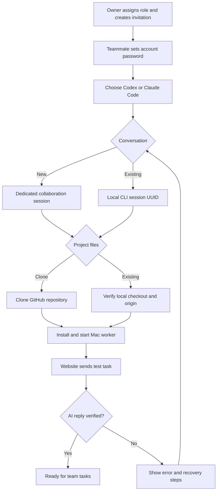

# Teammate setup

The owner creates a role in a project, opens **Team accounts**, and assigns that role when creating an invitation. The teammate opens the invitation, sets a password, and lands in `/setup`.



The wizard supplies one Terminal command. It downloads the worker and redeems a single-use setup grant valid for 30 minutes. The durable agent token is returned over HTTPS and saved in the worker’s private configuration; it is not embedded in the copied command. Generating another command invalidates the previous unused grant. Redeeming it rotates the agent token and clears an earlier connection test.

The repository is cloned into the selected folder. An existing folder must be a Git root with a matching GitHub origin; setup leaves a mismatched folder unchanged. Private repositories use the teammate’s configured GitHub authentication. The installer validates the provider login before installing a macOS LaunchAgent and prints its log location and stop command. The Mac must remain awake and online to receive work.

New conversations retain their provider session ID across turns and worker restarts. Existing sessions must be local and resumable through the selected provider CLI. A browser conversation link does not provide a resumable CLI transcript. Close another active turn before connecting the same session. A missing transcript, incompatible CLI, denied permission, or expired login is surfaced as a worker error. Resolve the reported issue or stop the worker and generate a command for a new session.

The connection test is a separate challenge, outside the normal task board. The worker asks the selected AI to echo a nonce with an empty action list, using Codex’s read-only sandbox or disabling Claude’s tools. It reports success only after validating the exact AI reply. The server requires the current worker lease and challenge. Requests are idempotent while a challenge is pending; it expires after ten minutes. Newly onboarded workers wait for this verification before starting project work. Verification does not mark any project task complete.

## Validation

Use the locked dependencies with Node.js 22.13 or later; Node.js 24 was used for the SQLite behavior check.

```sh
node --import tsx tests/onboarding.mjs
python3 -m unittest discover -s tests -p 'test_*.py'
npx tsc --noEmit --incremental false
npm run build
```

The automated worker tests use fake CLI executables and do not install a service, call a model API, or connect to a live workspace. They verify session IDs persist and are resumed, test replies are validated, and existing checkouts are protected. API tests apply all SQL migrations to an in-memory SQLite database and cover invitation redemption, account scoping, grants, lease conflicts, and round-trip verification.

Before release, complete a browser walkthrough and a test on a second Mac with both real provider CLIs, including an existing conversation. These remain separate from offline protocol tests.

## Rollout

After owner approval, apply `drizzle/0004_smooth_purple_man.sql` before deploying the application. It adds nullable `agents.account_id`, `setup_grants`, and `setup_checks`. Existing agent tokens and worker configurations remain compatible; unassigned agents do not enter the new onboarding flow. For an existing member without an assigned agent, use **Assign role** in Team accounts before they open the wizard. Existing workers must install the updated worker to handle connection-test challenges.

Do not mark the rollout complete until a real invitation has been redeemed on a second Mac and the website receives that AI’s connection-test reply. Deployments and merges require explicit owner approval under the repository instructions.
