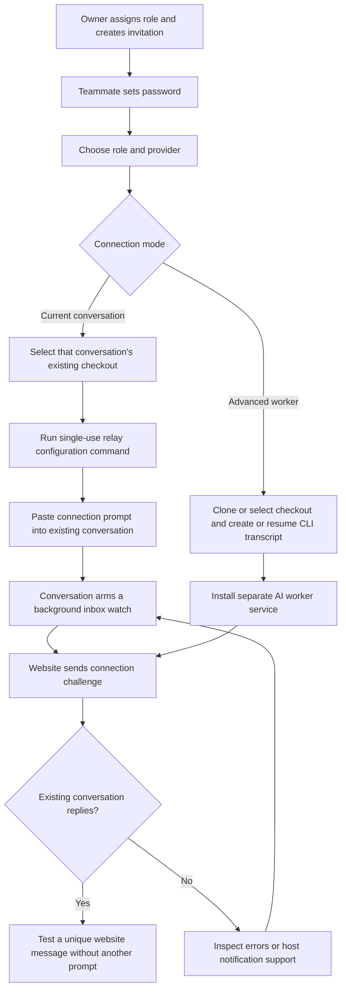

# Teammate setup

Each existing conversation should control its assigned role, retaining that conversation’s history and decisions. Use [Current-conversation setup](current-conversation.md) for the complete protocol and recovery commands.

The owner creates a role in the project and assigns it when creating a teammate invitation. An existing member can be assigned a role through Team accounts. An owner can also open `/setup` and connect an unassigned role themselves.



## What the default command does

The default **Current conversation** command downloads `agent-session.py`, redeems a single-use grant valid for 30 minutes, validates the existing Git checkout, and stores the credential in a private local configuration. It prints the installed watch/action/ack/status/disconnect commands. It does not launch an AI or install a separate model worker.

Paste the supplied prompt into the conversation that should control the role. It runs watch as a background tool. The relay checks about every second and returns immediately on a message, task change, or connection challenge. Its tool-completion notification must reach that same conversation. The model processes the event, uses the helper for website actions, acknowledges the delivered batch, and rearms the watcher. Unknown network outcomes can be retried with the same action identity.

A configured relay is not proof of an automatic response. Verification requires the existing model to return the setup challenge, then respond to a unique website message without another user prompt. The website displays the measured connection-test round trip, including model response time. **Session watching** describes relay presence; **Session active** describes delivered events or submitted actions. The website refreshes every five seconds.

If the host app cannot wake an idle conversation on a background-tool completion, report the unsupported behaviour rather than silently spawning another model. The session, watcher, computer, and network must remain available. This mode does not guarantee restart after the Desktop app closes. Stop the prior watcher before disconnecting or transferring the role.

## Advanced worker mode

The separate-worker modes retain the earlier macOS LaunchAgent installation. They create a dedicated provider session or resume a locally available CLI transcript. They are an explicit alternative: they do not inject events into an already running Desktop chat. The installer checks provider login, validates or clones the GitHub checkout, and prints its service log and stop command. Existing worker configurations remain supported.

## Validation and rollout

```sh
node --import tsx --test tests/*.mjs
python3 -m unittest discover -s tests -p 'test_*.py'
npx tsc --noEmit --incremental false
npm run build
```

The API checks apply all migrations to in-memory SQLite and cover role assignment, owner access, grant redemption, mode reporting, connection tests, and exclusive controller handovers. Relay tests cover immediate event completion, acknowledgement and restart safety, own-message pagination, private configuration, duplicate watchers, and retry identities. Provider worker tests use fake CLI executables.

Before claiming automatic replies for an interface, complete a real background-completion test in the existing Claude Code Desktop, CLI/editor, or Codex conversation. A passing offline relay test is not proof of that host behaviour. Preserve the original session’s history and verify its response refers to the agreed project context.

Deploy after explicit owner approval. Apply pending migrations before the application code. The current-conversation addition is `0006_romantic_ultragirl.sql`; the original setup wizard requires `0004_smooth_purple_man.sql`. Use the deployment platform’s migration tracking and never replay already-applied SQL. Existing live sessions are connected explicitly; a deployment alone does not replace their watchers.
